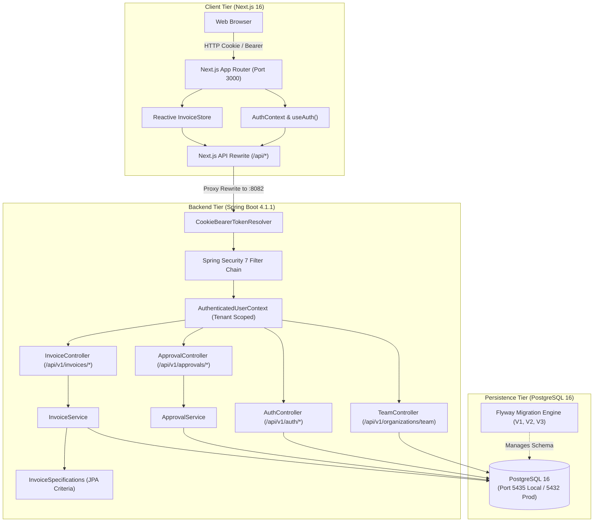

# FlowLedger

> **Modern Invoice Intake, Approval Workflow, and Audit Platform for Ethiopian Small and Medium Enterprises (SMEs)**

[](#testing)
[](#testing)
[](https://openjdk.org/)
[](https://spring.io/projects/spring-boot)
[](https://nextjs.org/)
[](https://www.postgresql.org/)

FlowLedger is an invoice intake and approval platform tailored to Ethiopian SMEs. It replaces manual paper trails, informal messaging approvals, and spreadsheet tracking with structured invoice entry, duplicate detection, Ethiopian Birr (ETB) compliance, role-based approval queues, and immutable audit logging.

---

## Architecture Overview

FlowLedger follows a decoupled, multi-tenant architecture designed for security, auditability, and responsive browser interactions.



### Key Architectural Tenets
1. **Strict Multi-Tenant Isolation:** Every invoice query and mutation derives tenant identity (`organizationId`) directly from the verified JWT claims via [`AuthenticatedUserContext`](flowLedger_backend/src/main/java/com/example/flowLedger_backend/security/AuthenticatedUserContext.java). Client-supplied organization IDs are never trusted.
2. **Dual-Delivery JWT Authentication:** Supports `HttpOnly; SameSite=Lax` browser cookies for seamless Next.js session management, while simultaneously accepting `Authorization: Bearer <token>` headers for automated API clients.
3. **Immutable Audit Trail:** All invoice transitions (`CREATED_DRAFT`, `SUBMITTED`, `EDITED`, `APPROVED`, `REJECTED`) append timestamped events to `invoice_activity` recording actor identity and decision rationale.
4. **Resilient Querying:** Dynamic JPA Criteria queries via [`InvoiceSpecifications`](flowLedger_backend/src/main/java/com/example/flowLedger_backend/invoices/InvoiceSpecifications.java) safeguard PostgreSQL against untyped parameter binding errors while optimizing index usage.

---

## Technology Stack

| Layer | Component | Version | Description |
|---|---|---|---|
| **Runtime & Language** | Java OpenJDK | 25.0.3 | Modern LTS Java runtime with virtual threads support |
| **Backend Framework** | Spring Boot | 4.1.1 | Enterprise application framework |
| **Security** | Spring Security & Nimbus JWT | 7.0 / 10.x | Stateless JWT resource server, BCrypt hashing |
| **Persistence** | Spring Data JPA / Hibernate | 7.4.5.Final | ORM with Criteria API query specifications |
| **Database** | PostgreSQL | 16.x | ACID-compliant relational storage |
| **Migrations** | Flyway Community | 12.0.1 | Version-controlled automated schema migrations |
| **Frontend Framework** | Next.js (App Router) | 16.4.2 | React server and client components, API proxy |
| **UI Library** | React | 19.3.0 | Modern UI rendering library |
| **Styling** | Tailwind CSS | 4.0 | Utility-first CSS engine |
| **Frontend Testing** | Vitest | 5.0.5 | Fast Vite-native unit and contract test runner |
| **Backend Testing** | JUnit 5 & Testcontainers | 6.0.3 / 2.0.5 | Ephemeral Dockerized PostgreSQL integration tests |

---

## Quickstart & Local Setup

### Prerequisites
- **Java Development Kit:** JDK 25 installed (`java -version`)
- **Node.js & npm:** Node.js v20+ and npm v10+
- **Docker & Docker Compose:** Docker daemon running for PostgreSQL containerization
- **Maven Wrapper:** Included (`./mvnw`)

### 1. Clone the Repository
```bash
git clone https://github.com/your-org/FlowLedger.git
cd FlowLedger
```

### 2. Start PostgreSQL
A pre-configured Docker Compose file is located in `flowLedger_backend`:
```bash
cd flowLedger_backend
docker compose up -d postgres
```
> [!NOTE]
> The database runs locally on port `5435` with database name `flowledger_db`, username `flowledger_app`, and password `flowledger_secret`.

### 3. Run the Backend Service
From the `flowLedger_backend` directory:
```bash
./mvnw spring-boot:run
```
The Spring Boot backend will start on **`http://localhost:8082`**. Flyway migrations will execute automatically, initializing the schema and demo seed data.

Verify health:
```bash
curl http://localhost:8082/actuator/health
# Output: {"status":"UP"}
```

### 4. Run the Next.js Frontend
In a new terminal window, navigate to the `frontend` directory:
```bash
cd frontend
npm install
npm run dev
```
The frontend will start on **`http://localhost:3000`**.

### 5. Access and Sign In
Open your browser to `http://localhost:3000/sign-in`.

Sign in with the seeded demo credentials:
- **Email:** `abebe@acme.co`
- **Password:** `password`
- **Organization:** Acme Trading Co. (`OWNER` role)

---

## Repository Structure

```
FlowLedger/
├── README.md                           # Master project guide (this file)
├── docs/                               # Comprehensive engineering documentation
│   ├── srs.md                          # Software Requirements Specification
│   ├── architecture.md                 # System Architecture & Design Document
│   ├── data-models.md                  # Database Schema, Tables & ERD
│   ├── api-contract.md                 # Detailed REST API Specifications
│   ├── openapi.yaml                    # OpenAPI 3.1.0 Contract
│   ├── security.md                     # Security Architecture & Threat Model
│   ├── testing.md                      # Testing Strategy, Pyramid & Test Matrix
│   └── deployment-operations.md        # Deployment, Docker & Runbooks
├── flowLedger_backend/                 # Spring Boot 4.1.1 Application
│   ├── pom.xml                         # Maven build definition & dependencies
│   ├── compose.yaml                    # Local Docker Compose PostgreSQL service
│   ├── src/main/java/com/example/flowLedger_backend/
│   │   ├── config/                     # SecurityConfig, CorsConfig, GlobalExceptionHandler
│   │   ├── identity/                   # AppUser, AuthController, AuthService, DTOs
│   │   ├── organization/               # Organization, Membership, TeamController
│   │   ├── invoices/                   # Invoice, InvoiceActivity, InvoiceService, ApprovalService
│   │   │   ├── dto/                    # Request and Response record DTOs
│   │   │   └── InvoiceSpecifications.java # CriteriaBuilder specification filters
│   │   └── security/                   # JwtService, CookieBearerTokenResolver, UserContext
│   ├── src/main/resources/
│   │   ├── application.properties      # Base Spring Boot configuration
│   │   └── db/migration/               # Versioned Flyway SQL migrations (V1, V2, V3)
│   └── src/test/java/                  # 30 Integration & Unit Tests (Testcontainers)
└── frontend/                           # Next.js 16.4.2 Application
    ├── package.json                    # Frontend dependencies and scripts
    ├── next.config.ts                  # Reverse proxy rewrite (/api/:path* -> :8082)
    ├── app/                            # App Router routes (public & authenticated)
    │   ├── (public)/sign-in/           # Sign-in view with credentials & demo fill
    │   └── (authenticated)/            # Protected layout, Dashboard, Invoices, Approvals, Team
    ├── components/                     # Reusable UI cards, tables, badges, and layout shell
    ├── features/                       # Domain feature views (auth, dashboard, invoices, approvals)
    ├── lib/api/client.ts               # Typed fetch wrapper with ApiError handling
    ├── services/                       # ApiInvoiceService, ApiApprovalService, teamService, store
    ├── types/                          # Shared TypeScript domain contracts (invoice.ts, auth.ts)
    └── tests/                          # 55 Vitest unit, contract, and validation tests
```

---

## Testing

FlowLedger adheres to strict automated testing standards across both backend and frontend.

### Running Backend Tests
The backend test suite executes 30 automated integration tests against real PostgreSQL instances managed via Testcontainers:
```bash
cd flowLedger_backend
./mvnw test -o
```
*(The `-o` offline flag skips remote Maven repo metadata checks for instant test execution).*

**Backend Test Breakdown:**
- **Auth & Session Tests (6):** Login, Logout, Cookie issuance, Invalid passwords, Token expiration, `/api/v1/me`.
- **Invoices Workflow Tests (4):** Draft creation, submission, duplicate number checking, dashboard metrics calculation.
- **Approvals & Roles Tests (5):** Pending queue listing, 1-click approvals, mandatory rejection reasons, role checks (blocking `VIEWER` with 403 Forbidden).
- **Security & Infrastructure Tests (15):** Password encoder cost factor, Flyway migration validation, Health actuator, Spring context bootstrap.

### Running Frontend Tests
The frontend test suite executes 55 automated unit and contract tests in Vitest:
```bash
cd frontend
npm test
```
To verify TypeScript type safety across all components and API contracts:
```bash
npx tsc --noEmit
```

**Frontend Test Breakdown:**
- **Validation Tests (17):** Amount formatting, date bounds, invoice numbers, rejection reasons.
- **API Services Contract Tests (13):** `ApiInvoiceService`, `ApiApprovalService`, `teamService`.
- **User Flows & Views Tests (21):** State transitions, reactive store updates, filter interactions.
- **Auth Context Tests (4):** Session hydration, cookie persistence, logout state clearing.

---

## Documentation Directory

| Document | Purpose |
|---|---|
| [**Software Requirements Specification (SRS)**](docs/srs.md) | Business requirements, user personas, functional specifications, and non-functional constraints. |
| [**Architecture & Design**](docs/architecture.md) | Detailed architectural diagrams, multi-tenant isolation model, and state transition engines. |
| [**Data Models & Database Schema**](docs/data-models.md) | ER diagrams, table schemas, data dictionary, indexing, and Flyway migration conventions. |
| [**API Specification**](docs/api-contract.md) | Full human-readable endpoint catalog with request/response schemas, error codes, and headers. |
| [**OpenAPI 3.1.0 Specification**](docs/openapi.yaml) | Standardized, machine-readable OpenAPI document for Swagger UI, Postman, and client SDKs. |
| [**Security Architecture**](docs/security.md) | STRIDE threat model, JWT mechanics, cookie security, CSRF/CORS defenses, and audit compliance. |
| [**Testing Strategy**](docs/testing.md) | Testing pyramid, Testcontainers execution, Vitest mock strategies, and CI/CD quality gates. |
| [**Deployment & Operations**](docs/deployment-operations.md) | Production Dockerfiles, container composition, environment variables, monitoring, and runbooks. |

---

## License

This project is licensed under the MIT License - see the `LICENSE` file for details.
