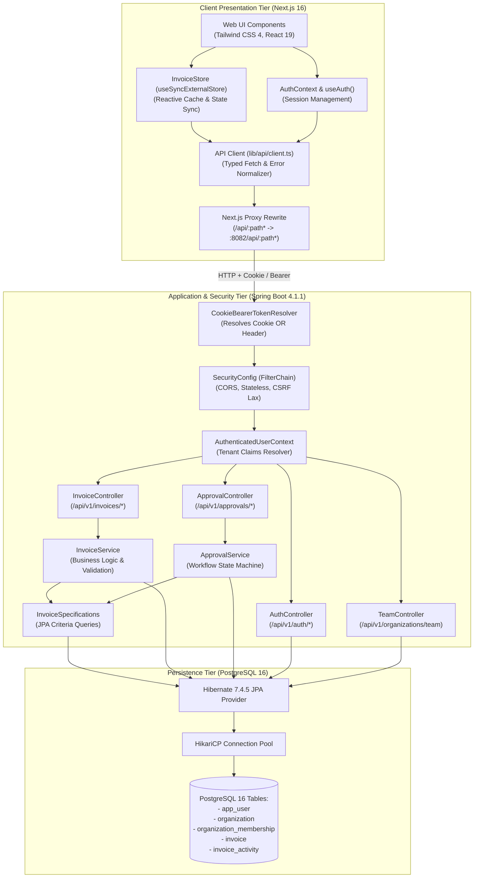
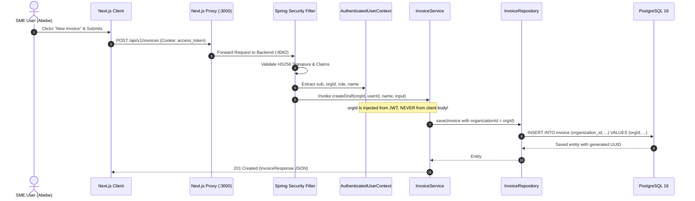
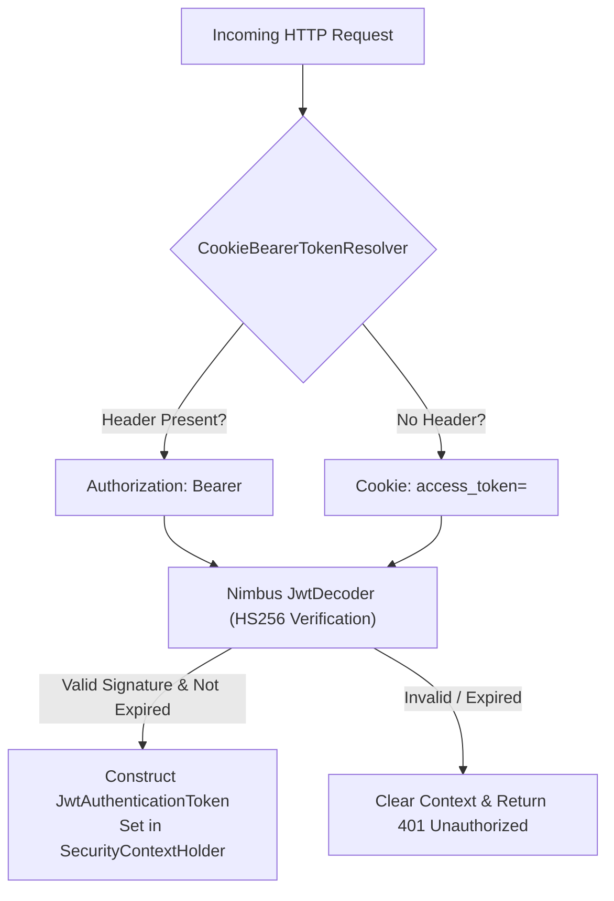
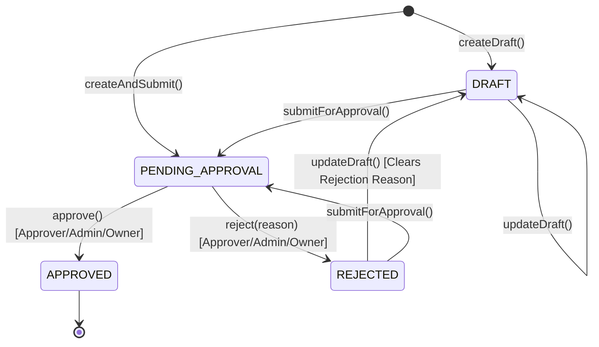
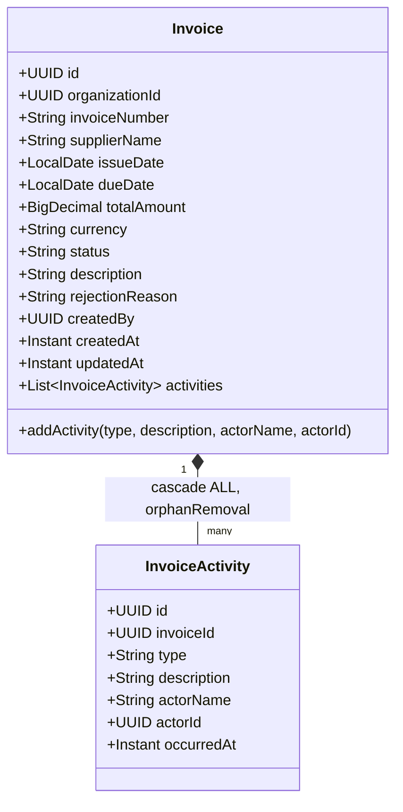

# System Architecture & Technical Design Document

**Project:** FlowLedger  
**Target Platform:** Ethiopian SME Invoicing & Workflow Management  
**Status:** Implemented & Verified  
**Runtime:** Java 25 LTS, Spring Boot 4.1.1, PostgreSQL 16, Next.js 16.4.2  

---

## 1. System Overview

FlowLedger is structured as a decoupled multi-tier web application designed to achieve high data isolation, robust auditability, and immediate responsiveness.

The architecture comprises three principal tiers:
1. **Frontend Presentation & Client State Tier:** Next.js 16 App Router application running React 19, Tailwind CSS 4, and an external reactive invoice store.
2. **Backend Application & Security Tier:** Spring Boot 4.1.1 REST API implementing Spring Security 7, Nimbus JWT, JPA business rules, and Flyway migration controls.
3. **Relational Persistence Tier:** PostgreSQL 16 database operating with strict foreign key constraints, composite tenant indexes, and full ACID guarantees.



---

## 2. Multi-Tenant Isolation Pattern

FlowLedger operates on a **Shared Database, Shared Schema with Discriminator Column** multi-tenancy model. Every domain entity is explicitly scoped to an `organization_id`.



### Defense Against Insecure Direct Object Reference (IDOR)
- **Zero Trust on Incoming Organization Identifiers:** Endpoints never accept an `organizationId` from the request query string or JSON payload.
- **Context Injection:** The [`AuthenticatedUserContext`](../flowLedger_backend/src/main/java/com/example/flowLedger_backend/security/AuthenticatedUserContext.java) service extracts the user's `organizationId` directly from the authenticated `Jwt` object in the `SecurityContextHolder`.
- **Query Scoping:** All database queries require `organizationId` as a mandatory `WHERE` clause constraint:
  ```java
  Optional<Invoice> findByIdAndOrganizationId(UUID id, UUID organizationId);
  ```
  If an authorized user from Organization A attempts to query an invoice belonging to Organization B by UUID, the repository returns an empty `Optional`, resulting in a safe `404 Not Found` response.

---

## 3. Dual Authentication & Token Delivery Architecture

FlowLedger supports two parallel delivery channels for authentication credentials:



### Token Mechanics
- **Algorithm:** HMAC-SHA256 (`MacAlgorithm.HS256`) with a 256-bit cryptographically secure secret key.
- **Token Claims Payload:**
  - `sub`: User ID (`UUID`)
  - `email`: User email address
  - `name`: User full name
  - `orgId`: Tenant Organization ID (`UUID`)
  - `role`: Membership role (`OWNER`, `ADMIN`, `FINANCE`, `APPROVER`, `VIEWER`)
  - `iat`: Issued At timestamp
  - `exp`: Expiration timestamp (default: 24 hours)

### Cookie Security Attributes
When issued by [`AuthController.java`](../flowLedger_backend/src/main/java/com/example/flowLedger_backend/identity/AuthController.java):
- **`HttpOnly`:** `true` (Cannot be read or manipulated by client-side JavaScript, neutralizing Cross-Site Scripting [XSS] token theft).
- **`SameSite`:** `Lax` (Prevents Cross-Site Request Forgery [CSRF] attacks while allowing normal top-level navigation).
- **`Path`:** `/` (Accessible across the entire application domain).
- **`Secure`:** Enabled in production environments over HTTPS.

---

## 4. Invoice State Machine & Lifecycle

The invoice state machine governs all legal lifecycle transitions and ensures business rules are strictly maintained:



### Transition Invariants
1. **Immutable States:** An invoice in `APPROVED` status is completely locked; no further edits or status transitions are allowed.
2. **Draft Modifications:** Only invoices in `DRAFT` or `REJECTED` status may be updated via `updateDraft()`. Attempting to modify a `PENDING_APPROVAL` or `APPROVED` invoice raises an `IllegalStateException` (HTTP 400).
3. **Mandatory Rejection Rationale:** An invoice can only transition to `REJECTED` if a non-blank justification string (minimum 3 characters) is provided. The reason is persisted in `invoice.rejection_reason` and recorded in the audit activity log.
4. **Resubmission:** If an invoice is rejected, editing its details automatically moves it back to `DRAFT` with the prior rejection note cleared, readying it for subsequent resubmission.

---

## 5. Audit Activity Logging Engine

FlowLedger incorporates an **immutable activity log** on every invoice. State transitions cannot occur without recording an audit event.



### Event Types
- `CREATED_DRAFT`: Initial draft saved by submitter.
- `SUBMITTED`: Submitted for formal approval.
- `EDITED`: Draft details modified prior to approval.
- `APPROVED`: Formal approval granted by authorized user.
- `REJECTED`: Invoice rejected with logged justification.

---

## 6. Dynamic Query Engine (Criteria API)

To support flexible filtering across statuses, suppliers, invoice numbers, and date ranges without falling victim to PostgreSQL type-inference defects (such as `lower(bytea)` when binding nullable parameters in raw JPQL), FlowLedger utilizes the **JPA Criteria API Specification Pattern** in [`InvoiceSpecifications.java`](../flowLedger_backend/src/main/java/com/example/flowLedger_backend/invoices/InvoiceSpecifications.java):

```java
public static Specification<Invoice> withFilters(
        UUID orgId,
        String status,
        String search,
        LocalDate fromDate,
        LocalDate toDate
) {
    return (root, query, cb) -> {
        List<Predicate> predicates = new ArrayList<>();
        predicates.add(cb.equal(root.get("organizationId"), orgId));

        if (status != null && !status.isBlank() && !"ALL".equalsIgnoreCase(status)) {
            predicates.add(cb.equal(root.get("status"), status.toUpperCase()));
        }

        if (search != null && !search.isBlank()) {
            String pattern = "%" + search.trim().toLowerCase() + "%";
            Predicate supplierLike = cb.like(cb.lower(root.get("supplierName")), pattern);
            Predicate invoiceNumLike = cb.like(cb.lower(root.get("invoiceNumber")), pattern);
            predicates.add(cb.or(supplierLike, invoiceNumLike));
        }

        if (fromDate != null) {
            predicates.add(cb.greaterThanOrEqualTo(root.get("issueDate"), fromDate));
        }

        if (toDate != null) {
            predicates.add(cb.lessThanOrEqualTo(root.get("issueDate"), toDate));
        }

        return cb.and(predicates.toArray(new Predicate[0]));
    };
}
```

**Benefits:**
- **Zero Null-Parameter Cast Errors:** Only non-null filters generate SQL `WHERE` clauses. If `search` is omitted, no `LIKE` expressions are compiled.
- **Index Optimization:** Database query planner utilizes the `idx_invoice_org_num` composite index without synthetic parameter wrapping.
- **Type Safety:** Criteria compiler guarantees field name and type checking at build time.

---

## 7. Cross-Cutting Technical Concerns

### 7.1 Unified Error Representation (RFC 7807)
All error responses from the backend adhere to a standardized JSON schema handled by [`GlobalExceptionHandler.java`](../flowLedger_backend/src/main/java/com/example/flowLedger_backend/config/GlobalExceptionHandler.java):

```json
{
  "timestamp": "2026-11-03T20:20:00Z",
  "status": 400,
  "error": "Bad Request",
  "message": "Rejection reason is required and must not be blank",
  "path": "/api/v1/approvals/d3b07384-d113-40a8-b649-0112f4553221/reject"
}
```

### 7.2 Connection Pooling & Transaction Management
- Connection management is managed by **HikariCP** with sensible pool defaults (max pool size: 10, minimum idle: 5, connection timeout: 30,000 ms).
- All mutative business logic runs inside `@Transactional` boundaries. If an activity log creation fails or a repository update encounters an error, the entire database transaction rolls back, guaranteeing zero orphaned or inconsistent state records.
