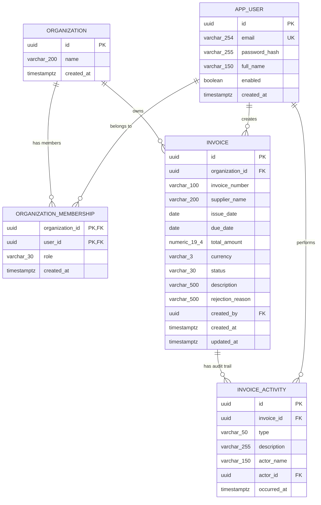

# Data Models & Database Schema Specification

**Project:** FlowLedger  
**Database Engine:** PostgreSQL 16  
**Migration Tool:** Flyway Community 12.0.1  
**Timezone:** UTC (`TIMESTAMPTZ`)  
**Character Encoding:** `UTF-8`  

---

## 1. Entity-Relationship Diagram (ERD)

---

## 2. Table Specifications

### 2.1 `app_user`
Stores user identities, login credentials, and global profile attributes.

| Column | Data Type | Nullable | Default | Constraints & Description |
|---|---|---|---|---|
| `id` | `UUID` | No | None | **Primary Key**. Unique user identifier. |
| `email` | `VARCHAR(254)` | No | None | User email address. RFC 5321 length. Indexed uniquely case-insensitively. |
| `password_hash` | `VARCHAR(255)` | No | None | Salted BCrypt password hash. |
| `full_name` | `VARCHAR(150)` | No | None | Display and audit full name. |
| `enabled` | `BOOLEAN` | No | `TRUE` | Whether the user account is active. |
| `created_at` | `TIMESTAMPTZ` | No | `CURRENT_TIMESTAMP` | Account creation timestamp in UTC. |

**Indexes & Keys:**
- `pk_app_user` on `id` (`PRIMARY KEY`)
- `uq_app_user_email` on `LOWER(email)` (`UNIQUE INDEX`)

---

### 2.2 `organization`
Represents an SME tenant organization boundary.

| Column | Data Type | Nullable | Default | Constraints & Description |
|---|---|---|---|---|
| `id` | `UUID` | No | None | **Primary Key**. Unique organization identifier. |
| `name` | `VARCHAR(200)` | No | None | Legal or commercial name of the business. |
| `created_at` | `TIMESTAMPTZ` | No | `CURRENT_TIMESTAMP` | Organization registration timestamp in UTC. |

**Indexes & Keys:**
- `pk_organization` on `id` (`PRIMARY KEY`)

---

### 2.3 `organization_membership`
Associates a user with an organization, assigning an organizational role.

| Column | Data Type | Nullable | Default | Constraints & Description |
|---|---|---|---|---|
| `organization_id` | `UUID` | No | None | **Composite Primary Key (1/2)**. Foreign key to `organization(id)`. |
| `user_id` | `UUID` | No | None | **Composite Primary Key (2/2)**. Foreign key to `app_user(id)`. |
| `role` | `VARCHAR(30)` | No | None | Role assigned to user in this tenant. |
| `created_at` | `TIMESTAMPTZ` | No | `CURRENT_TIMESTAMP` | Membership creation timestamp in UTC. |

**Constraints & Indexes:**
- Composite Primary Key: `(organization_id, user_id)`
- Foreign Key: `organization_id REFERENCES organization(id) ON DELETE CASCADE`
- Foreign Key: `user_id REFERENCES app_user(id) ON DELETE CASCADE`
- Check Constraint `chk_membership_role`: `role IN ('OWNER', 'ADMIN', 'FINANCE', 'APPROVER', 'VIEWER')`
- Index `idx_membership_user` on `user_id` (optimizes user organization lookup at login)

---

### 2.4 `invoice`
Core invoice entity storing financial details, workflow status, and tenant association.

| Column | Data Type | Nullable | Default | Constraints & Description |
|---|---|---|---|---|
| `id` | `UUID` | No | None | **Primary Key**. Unique invoice identifier. |
| `organization_id` | `UUID` | No | None | Foreign key to `organization(id)`. Tenant boundary. |
| `invoice_number` | `VARCHAR(100)` | No | None | Supplier-issued invoice number (e.g. `INV-2026-001`). |
| `supplier_name` | `VARCHAR(200)` | No | None | Legal name of vendor/supplier. |
| `issue_date` | `DATE` | Yes | None | Official date invoice was issued. |
| `due_date` | `DATE` | Yes | None | Payment due date. |
| `total_amount` | `NUMERIC(19, 4)` | No | None | Total amount payable. Stored with 4 decimal places for precision. |
| `currency` | `VARCHAR(3)` | No | `'ETB'` | 3-letter currency code (ISO 4217, e.g. `ETB`, `USD`, `EUR`). |
| `status` | `VARCHAR(30)` | No | `'DRAFT'` | Workflow status: `DRAFT`, `PENDING_APPROVAL`, `APPROVED`, `REJECTED`, `CANCELLED`. |
| `description` | `VARCHAR(500)` | Yes | None | Optional memo or line item summary. |
| `rejection_reason` | `VARCHAR(500)` | Yes | None | Mandatory justification if rejected by an approver. |
| `created_by` | `UUID` | No | None | Foreign key to `app_user(id)` who initiated the invoice. |
| `created_at` | `TIMESTAMPTZ` | No | `CURRENT_TIMESTAMP` | Record creation timestamp. |
| `updated_at` | `TIMESTAMPTZ` | No | `CURRENT_TIMESTAMP` | Last modification timestamp. |

**Indexes & Keys:**
- `pk_invoice` on `id` (`PRIMARY KEY`)
- Foreign Key: `organization_id REFERENCES organization(id)`
- Foreign Key: `created_by REFERENCES app_user(id)`
- Check Constraint `chk_invoice_status`: `status IN ('DRAFT', 'PENDING_APPROVAL', 'APPROVED', 'REJECTED', 'CANCELLED')`
- Index `idx_invoice_org_num` on `(organization_id, LOWER(invoice_number))` (accelerates duplicate checks and tenant searches)

---

### 2.5 `invoice_activity`
Immutable append-only audit trail capturing all state transitions and user actions.

| Column | Data Type | Nullable | Default | Constraints & Description |
|---|---|---|---|---|
| `id` | `UUID` | No | None | **Primary Key**. Unique activity event identifier. |
| `invoice_id` | `UUID` | No | None | Foreign key to `invoice(id)`. |
| `type` | `VARCHAR(50)` | No | None | Event type: `CREATED_DRAFT`, `SUBMITTED`, `EDITED`, `APPROVED`, `REJECTED`. |
| `description` | `VARCHAR(255)` | No | None | Human-readable explanation (e.g. "Invoice approved by Abebe Girma"). |
| `actor_name` | `VARCHAR(150)` | Yes | None | Display name of the user performing the action. |
| `actor_id` | `UUID` | Yes | None | Foreign key to `app_user(id)`. Nullable for system events. |
| `occurred_at` | `TIMESTAMPTZ` | No | `CURRENT_TIMESTAMP` | Exact UTC timestamp event occurred. |

**Indexes & Keys:**
- `pk_invoice_activity` on `id` (`PRIMARY KEY`)
- Foreign Key: `invoice_id REFERENCES invoice(id) ON DELETE CASCADE`
- Foreign Key: `actor_id REFERENCES app_user(id)`
- Index `idx_activity_invoice` on `(invoice_id, occurred_at DESC)` (optimizes chronological timeline rendering)

---

## 3. Flyway Database Migrations

All schema modifications are strictly version-controlled via Flyway scripts located in:  
[`flowLedger_backend/src/main/resources/db/migration/`](../flowLedger_backend/src/main/resources/db/migration/)

### Migration History

| Version | Migration Script | Description |
|---|---|---|
| **V1** | [`V1__initial_schema.sql`](../flowLedger_backend/src/main/resources/db/migration/V1__initial_schema.sql) | Baseline schema creating `app_user`, `organization`, `organization_membership`, `invoice`, and primary indexes. |
| **V2** | [`V2__seed_demo_data.sql`](../flowLedger_backend/src/main/resources/db/migration/V2__seed_demo_data.sql) | Seeds initial demo tenant *Acme Trading Co.* (`11111111-1111-1111-1111-111111111111`) and demo user `abebe@acme.co` with salted BCrypt password hash. |
| **V3** | [`V3__enhance_invoice_and_activity_schema.sql`](../flowLedger_backend/src/main/resources/db/migration/V3__enhance_invoice_and_activity_schema.sql) | Adds `description` and `rejection_reason` to `invoice`, sets `currency` type to `VARCHAR(3)`, and creates `invoice_activity` table and indexes. |

---

## 4. Key Data Modeling Decisions

1. **UUIDs for All Identifiers:** FlowLedger uses Version 4 random UUIDs across all entities. This mitigates sequential ID enumeration attacks, allows secure distributed generation, and prevents unauthorized cross-tenant object guessing.
2. **`NUMERIC(19, 4)` for Financial Amounts:** Floating-point representations (`FLOAT`, `DOUBLE`) introduce IEEE 754 precision inaccuracies. Using `NUMERIC(19, 4)` in PostgreSQL and `java.math.BigDecimal` in Spring Boot preserves cent and fractional cent accuracy for financial integrity.
3. **`TIMESTAMPTZ` for Temporal Data:** All timestamps include timezone information stored in UTC. Client presentation layers format timestamps according to the end-user's local browser timezone (e.g. East Africa Time, UTC+3).
4. **Denormalized Actor Name in Activity Trail:** To preserve an immutable audit record, `actor_name` is recorded as a string at event time. If a user later updates their name or leaves the company, historical audit records reflect the exact actor identity at the time the action took place.
