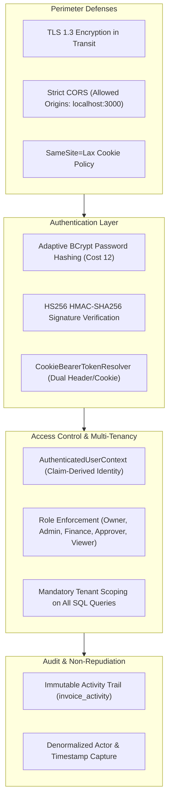

# Security Architecture & Threat Model

**Project:** FlowLedger  
**Classification:** Internal Technical Architecture & Security Guidelines  
**Status:** Approved & Enforced  

---

## 1. Overview & Security Philosophy

FlowLedger is built upon the principle of **Defense in Depth** and **Zero Trust at Tenant Boundaries**. Because financial invoices, payment approval workflows, and organizational records represent high-value business assets, every layer of the architecture enforces strict isolation, cryptographic verification, and non-repudiation.



---

## 2. STRIDE Threat Model & Mitigations

The system has been analyzed against the Microsoft STRIDE threat categorization framework:

| Threat Category | Potential Threat | FlowLedger Architectural Mitigation |
|---|---|---|
| **Spoofing (Identity)** | Adversary attempts to forge authentication tokens or impersonate another user. | - Passwords verified with BCrypt (cost factor 12).<br>- JWTs cryptographically signed with 256-bit HMAC secret.<br>- Tokens validated for expiration and signature on every request by Spring Security's Nimbus decoder. |
| **Tampering (Data)** | Attacker alters invoice amounts, approval states, or organization IDs in transit or at rest. | - Zero trust on client payloads: `organizationId` is never accepted in request bodies.<br>- State transitions validated by strict business rules in `InvoiceService` and `ApprovalService`.<br>- TLS 1.3 prevents tampering in transit. |
| **Repudiation** | An approver approves or rejects an invoice and later denies having taken the action. | - Mandatory audit record written to `invoice_activity` in the same database transaction.<br>- Captures immutable actor name, user UUID, action type, description, and UTC timestamp.<br>- Database constraints prevent update or deletion of activity records. |
| **Information Disclosure** | An attacker accesses another organization's invoices (IDOR) or steals tokens via XSS. | - `HttpOnly` cookie prevents JavaScript reading access tokens.<br>- All database queries filter by authenticated `organizationId` from JWT claims.<br>- Standardized error handler strips stack traces and database schema details. |
| **Denial of Service** | Volumetric requests or heavy unfiltered queries exhaust database connections. | - Dynamic JPA Criteria queries generate lean SQL without unnecessary full table scans.<br>- HikariCP pool bounded to maximum 10 active connections.<br>- Pagination enforced on all listing endpoints with maximum page size limits. |
| **Elevation of Privilege** | A user with the `VIEWER` role executes an invoice approval or rejection. | - Role checks enforced at the service and controller layer (`hasRole('VIEWER')` blocks write actions with HTTP 403 Forbidden).<br>- Only `OWNER`, `ADMIN`, and `APPROVER` can execute status transitions to `APPROVED` or `REJECTED`. |

---

## 3. Authentication Architecture & Token Mechanics

### 3.1 Dual Delivery Strategy
To balance the security of browser-based single-page applications with the flexibility of server-to-server API clients:
1. **Web Browser Clients:** Tokens are delivered in an `HttpOnly` cookie (`access_token`). The browser automatically includes the cookie in same-origin requests without requiring JavaScript exposure.
2. **API & Automated Clients:** Tokens are included in the JSON login response (`accessToken`) and can be supplied via standard `Authorization: Bearer <token>` headers.

The [`CookieBearerTokenResolver`](../flowLedger_backend/src/main/java/com/example/flowLedger_backend/security/CookieBearerTokenResolver.java) checks the `Authorization` header first; if absent, it checks the `access_token` cookie.

### 3.2 Cookie Security Configuration
When written to the HTTP response header:
```
Set-Cookie: access_token=<JWT>; Path=/; Max-Age=86400; HttpOnly; SameSite=Lax
```
- **`HttpOnly`:** Disallows access from `document.cookie`, preventing token exfiltration via Cross-Site Scripting (XSS).
- **`SameSite=Lax`:** Provides defense against Cross-Site Request Forgery (CSRF). Third-party origins cannot trigger cross-site state-changing POST requests with the cookie attached.
- **`Path=/`:** Restricts token transmission to application paths.
- **`Secure`:** Configured for HTTPS transmission in staging and production.

### 3.3 JWT Cryptographic Parameters
- **Algorithm:** HMAC using SHA-256 (`MacAlgorithm.HS256`).
- **Nimbus Encoder Configuration:** Explicitly configured via `JwsHeader.with(MacAlgorithm.HS256).build()` to prevent default fallback issues or algorithm confusion attacks (`none` algorithm).
- **Secret Management:** The signing key is supplied via `jwt.secret` (environment variable `JWT_SECRET`). It must be a minimum 256-bit (32-byte) cryptographically secure random string.

### 3.4 Password Hashing
- Stored in `app_user.password_hash`.
- Uses Spring Security's `BCryptPasswordEncoder` configured with **strength 12** (4,096 iterations).
- Automatically incorporates cryptographically random salts per password, neutralizing rainbow table attacks.

---

## 4. Authorization & Multi-Tenancy Boundary Enforcement

### 4.1 Claim-Derived Context (`AuthenticatedUserContext`)
FlowLedger rejects client-supplied tenant identifiers. The user's active tenant context is extracted directly from the verified JWT claims:

```java
@Component
public class AuthenticatedUserContext {
    public UUID getOrganizationId() {
        Jwt jwt = getJwt();
        return UUID.fromString(jwt.getClaimAsString("orgId"));
    }
    public UUID getUserId() {
        Jwt jwt = getJwt();
        return UUID.fromString(jwt.getSubject());
    }
    public String getRole() {
        Jwt jwt = getJwt();
        return jwt.getClaimAsString("role");
    }
}
```

### 4.2 Insecure Direct Object Reference (IDOR) Immunity
When a client requests an invoice by ID (`GET /api/v1/invoices/{id}`), the query is bound to the user's organization:
```sql
SELECT * FROM invoice 
WHERE id = :invoiceId 
  AND organization_id = :orgId;
```
If an attacker attempts to probe UUIDs belonging to other organizations, the query returns no rows, resulting in an immediate `404 Not Found`.

### 4.3 Role-Based Access Control (RBAC)
Controllers and services enforce role checks:
- **Approval Actions:** Only `OWNER`, `ADMIN`, and `APPROVER` roles can execute `POST /approvals/{id}/approve` or `POST /approvals/{id}/reject`. `VIEWER` is strictly rejected with HTTP 403 Forbidden.
- **Draft Creation & Submission:** `OWNER`, `ADMIN`, `FINANCE`.

---

## 5. Web Application Protections

### 5.1 Cross-Origin Resource Sharing (CORS)
Configured in [`SecurityConfig.java`](../flowLedger_backend/src/main/java/com/example/flowLedger_backend/config/SecurityConfig.java):
```java
CorsConfiguration config = new CorsConfiguration();
config.setAllowedOrigins(List.of("http://localhost:3000"));
config.setAllowedMethods(List.of("GET", "POST", "PUT", "DELETE", "OPTIONS"));
config.setAllowedHeaders(List.of("*"));
config.setAllowCredentials(true);
```
Unregistered origins are blocked at the filter level before reaching application endpoints.

### 5.2 SQL Injection Defenses
- All entity operations utilize Spring Data JPA repositories.
- Complex queries use the **JPA Criteria API** ([`InvoiceSpecifications.java`](../flowLedger_backend/src/main/java/com/example/flowLedger_backend/invoices/InvoiceSpecifications.java)), ensuring dynamic predicates are compiled via strongly typed CriteriaBuilder objects and bound through parameterized JDBC statements.

### 5.3 Safe Error Responses
Uncaught exceptions are processed by [`GlobalExceptionHandler.java`](../flowLedger_backend/src/main/java/com/example/flowLedger_backend/config/GlobalExceptionHandler.java), preventing leakage of:
- Database column or table names
- SQL syntax error details
- Java stack traces or internal framework class names

---

## 6. Auditability & Compliance

1. **Non-Repudiation:** Every lifecycle event records the user's full name and UUID at the exact moment the transition occurred.
2. **Referential Integrity:** Activity logs maintain a foreign key to `app_user(id)`. If a user account is deleted, foreign keys handle clean referencing while keeping the historical audit text intact.
3. **Immutability:** The `invoice_activity` table does not provide `UPDATE` endpoints, and Hibernate entity mappings omit mutators on audit records.
