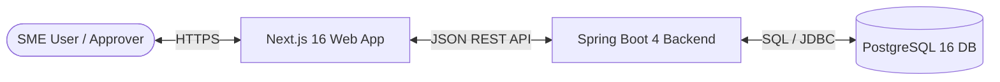

# Software Requirements Specification (SRS)
## Project: FlowLedger — Ethiopian SME Invoice Intake & Approval Platform

**Document Version:** 1.0.0  
**Status:** Approved & Implemented  
**Date:** November 2026  

---

## 1. Introduction

### 1.1 Purpose
This Software Requirements Specification (SRS) establishes the complete functional and non-functional requirements for **FlowLedger**, an invoice intake, tracking, approval, and audit platform engineered specifically for Small and Medium Enterprises (SMEs) in Ethiopia.

### 1.2 Scope of the System
FlowLedger provides a streamlined, secure, multi-tenant web application that eliminates manual paper handling, informal messaging (e.g. Telegram/WhatsApp) approval channels, and unversioned spreadsheet trackers.

The system encompasses:
- Multi-tenant tenant boundary isolation with organization-scoped data access.
- Role-based access control (RBAC) supporting Owner, Admin, Finance, Approver, and Viewer roles.
- Invoice intake with duplicate invoice number detection and Ethiopian Birr (ETB) compliance.
- Structured invoice state transitions (`DRAFT` → `PENDING_APPROVAL` → `APPROVED` / `REJECTED`).
- Enforced rejection rationale with mandatory non-empty justification.
- Immutable audit activity trail recording every lifecycle transition and actor details.
- Real-time aggregated organizational dashboard metrics.
- Organization team member management.

### 1.3 Definitions, Acronyms, and Abbreviations
- **SME:** Small and Medium Enterprise.
- **ETB:** Ethiopian Birr (national currency code).
- **JWT:** JSON Web Token (RFC 7519).
- **RBAC:** Role-Based Access Control.
- **IDOR:** Insecure Direct Object Reference.
- **CSRF:** Cross-Site Request Forgery.
- **CORS:** Cross-Origin Resource Sharing.
- **HS256:** HMAC using SHA-256 hash algorithm.
- **JPA:** Jakarta Persistence API.

---

## 2. Overall Description

### 2.1 Product Perspective
FlowLedger operates as a cloud-ready, containerized client-server system consisting of a React/Next.js frontend communicating with a Spring Boot 4 REST API, backed by a PostgreSQL 16 relational database.

### 2.2 User Classes and Roles

The platform enforces five distinct organizational roles:

| Role | Responsibilities & Permissions |
|---|---|
| **OWNER** | Full administrative and organizational authority. Can manage billing, team members, create invoices, approve, reject, and view all audit activities. |
| **ADMIN** | Organizational administrator. Can invite users, manage settings, submit invoices, approve/reject invoices, and view audit activities. |
| **FINANCE** | Accounting and finance staff. Responsible for invoice intake, creating drafts, submitting invoices for approval, and monitoring payment queues. Cannot self-approve invoices without approver rights. |
| **APPROVER** | Management personnel authorized to review submitted invoices and make approval or rejection decisions. |
| **VIEWER** | Read-only access for auditors, external accountants, or observers. Cannot create, edit, approve, or reject invoices. |

### 2.3 Operating Environment
- **Server OS:** Linux (Ubuntu 22.04 LTS / 24.04 LTS, containerized via Alpine or Distroless).
- **Runtime:** Java 25 LTS (OpenJDK).
- **Database:** PostgreSQL 16 with UTC time zone and `UTF-8` character encoding.
- **Client Browsers:** Modern Chromium-based browsers, Firefox, Safari, and Edge.

---

## 3. Functional Requirements

### 3.1 Authentication & Session Management (FR-AUTH)

- **FR-AUTH-1:** The system shall authenticate users using email and password via `POST /api/v1/auth/login`.
- **FR-AUTH-2:** Passwords must be verified against salted, adaptive BCrypt hashes with a minimum cost factor of 12.
- **FR-AUTH-3:** Upon successful authentication, the system shall issue an HS256-signed JWT containing:
  - Subject (`sub`): User UUID
  - Email (`email`): Lowercase verified user email
  - Name (`name`): User full name
  - Organization ID (`orgId`): Primary organization UUID
  - Role (`role`): User role within the organization
- **FR-AUTH-4:** The JWT shall be delivered via both:
  1. An `HttpOnly`, `SameSite=Lax`, `Path=/` cookie (`access_token`).
  2. The JSON response body (`accessToken`) for programmatic clients.
- **FR-AUTH-5:** The system shall provide `GET /api/v1/me` to return current authenticated user profile, organization details, and permissions.
- **FR-AUTH-6:** The system shall provide `POST /api/v1/auth/logout` which expires and clears the authentication cookie.

### 3.2 Multi-Tenant Isolation (FR-TENANT)

- **FR-TENANT-1:** Every organization's data must be logically separated.
- **FR-TENANT-2:** All incoming API requests must extract the tenant ID strictly from the verified JWT claims (`orgId`). The backend must reject or ignore any client-supplied organization ID query or body parameter.
- **FR-TENANT-3:** Invoices, approvals, team memberships, and audit trails belonging to Organization A must never be accessible or modifiable by users of Organization B under any circumstances (protection against IDOR).

### 3.3 Invoice Intake & Management (FR-INV)

- **FR-INV-1:** The system shall permit authorized users (`OWNER`, `ADMIN`, `FINANCE`) to create invoice drafts via `POST /api/v1/invoices`.
- **FR-INV-2:** Invoices must require:
  - Supplier Name (1 to 200 characters)
  - Invoice Number (1 to 100 characters)
  - Issue Date (Valid ISO-8601 date, format `YYYY-MM-DD`)
  - Total Amount (Positive decimal number, precision up to 19 digits with 4 decimal places)
  - Currency (3-character ISO code, defaulting to `ETB`)
- **FR-INV-3:** Invoices may include optional fields:
  - Due Date (`YYYY-MM-DD`, must not precede Issue Date if provided)
  - Description (Up to 500 characters)
- **FR-INV-4:** The system shall provide `GET /api/v1/invoices/check-duplicate` to check if an invoice number has already been entered for the tenant organization, enabling real-time duplicate warnings before submission.
- **FR-INV-5:** The system shall allow users to create and immediately submit an invoice for approval in a single transaction via `POST /api/v1/invoices/submit`.
- **FR-INV-6:** Existing invoices in `DRAFT` or `REJECTED` status may be submitted for approval via `POST /api/v1/invoices/{id}/submit`, which transitions the status to `PENDING_APPROVAL`.
- **FR-INV-7:** Only invoices in `DRAFT` or `REJECTED` status may be modified via `PUT /api/v1/invoices/{id}`. Invoices in `PENDING_APPROVAL` or `APPROVED` status must be immutable to edits.
- **FR-INV-8:** The system shall provide `GET /api/v1/invoices` with pagination, sort options, and filtering by:
  - Status (`DRAFT`, `PENDING_APPROVAL`, `APPROVED`, `REJECTED`, `ALL`)
  - Free-text search on Supplier Name or Invoice Number (case-insensitive substring)
  - Date Range (`fromDate` and `toDate`)

### 3.4 Approval Workflow & Role Enforcement (FR-APPR)

- **FR-APPR-1:** The system shall provide an approvals inbox via `GET /api/v1/approvals/pending` listing all invoices in `PENDING_APPROVAL` status for the authenticated user's organization.
- **FR-APPR-2:** Authorized roles (`OWNER`, `ADMIN`, `APPROVER`) may approve a pending invoice via `POST /api/v1/approvals/{id}/approve`, transitioning the status to `APPROVED`.
- **FR-APPR-3:** Users with the `VIEWER` role must receive an HTTP `403 Forbidden` response if attempting to approve or reject an invoice.
- **FR-APPR-4:** Authorized roles may reject a pending invoice via `POST /api/v1/approvals/{id}/reject`, transitioning the status to `REJECTED`.
- **FR-APPR-5:** Rejection must mandate a non-empty `reason` string (at least 3 characters). If the reason is blank, the request must fail with HTTP `400 Bad Request`.
- **FR-APPR-6:** When an invoice is rejected, the rejection reason must be permanently recorded on the invoice record and displayed prominently to the submitter.

### 3.5 Audit Activity Trail (FR-AUDIT)

- **FR-AUDIT-1:** Every state modification must trigger an audit record in `invoice_activity`:
  - `CREATED_DRAFT`: When a draft is created.
  - `SUBMITTED`: When an invoice is submitted for approval.
  - `EDITED`: When draft details are updated.
  - `APPROVED`: When an approver grants approval.
  - `REJECTED`: When an approver rejects an invoice (storing the reason in the activity description).
- **FR-AUDIT-2:** Each activity record must capture:
  - Unique Activity UUID
  - Foreign key to Invoice UUID
  - Event Type
  - Event Description
  - Actor Name and Actor UUID
  - Immutable UTC Timestamp (`occurred_at`)
- **FR-AUDIT-3:** Activity records are immutable; once written, they cannot be updated or deleted.

### 3.6 Dashboard Metrics (FR-DASH)

- **FR-DASH-1:** The system shall provide `GET /api/v1/invoices/summary` computing real-time organizational metrics:
  - Total count of invoices
  - Count of invoices pending approval
  - Count of approved invoices
  - Count of rejected invoices
  - Count of draft invoices
  - Top 5 recent invoices sorted by update timestamp descending
  - Current queue of pending approvals

### 3.7 Team Management (FR-TEAM)

- **FR-TEAM-1:** The system shall provide `GET /api/v1/organizations/team` returning all registered members belonging to the authenticated tenant organization, including full name, email, role, and active status.

---

## 4. Non-Functional Requirements

### 4.1 Security Requirements (NFR-SEC)
- **NFR-SEC-1:** All transport communication must enforce TLS 1.3 (or 1.2 minimum) in staging and production.
- **NFR-SEC-2:** Cookies must enforce `HttpOnly` (preventing XSS access) and `SameSite=Lax` (preventing cross-site request forgery).
- **NFR-SEC-3:** All database queries must use parameterized statements or JPA Criteria builders to prevent SQL injection.
- **NFR-SEC-4:** Error responses must never leak stack traces, internal database schema names, or vendor error details. Errors must conform to RFC 7807 problem details format.

### 4.2 Performance & Scalability (NFR-PERF)
- **NFR-PERF-1:** API response times for standard queries (`GET /invoices`, `GET /summary`, `GET /me`) must execute in less than 200 ms under normal load.
- **NFR-PERF-2:** Database connection pool (HikariCP) must be sized appropriately to support concurrent transactions without connection exhaustion.
- **NFR-PERF-3:** Database indexes must cover tenant lookups:
  - `idx_membership_user` on `organization_membership(user_id)`
  - `uq_app_user_email` on `app_user(LOWER(email))`
  - `idx_invoice_org_num` on `invoice(organization_id, LOWER(invoice_number))`
  - `idx_activity_invoice` on `invoice_activity(invoice_id, occurred_at DESC)`

### 4.3 Data Integrity & Reliability (NFR-REL)
- **NFR-REL-1:** Database migrations must be fully automated, repeatable, and managed by Flyway.
- **NFR-REL-2:** Monetary values must use PostgreSQL `NUMERIC(19, 4)` and Java `BigDecimal` to prevent floating-point rounding errors.
- **NFR-REL-3:** Referential integrity must be enforced via foreign keys with `ON DELETE CASCADE` for activity logs when an invoice is purged.

### 4.4 Usability & Accessibility (NFR-UX)
- **NFR-UX-1:** The user interface must be fully responsive across mobile, tablet, and desktop viewports.
- **NFR-UX-2:** The frontend must conform to WCAG 2.1 AA contrast standards, keyboard navigability, and ARIA accessibility guidelines.
