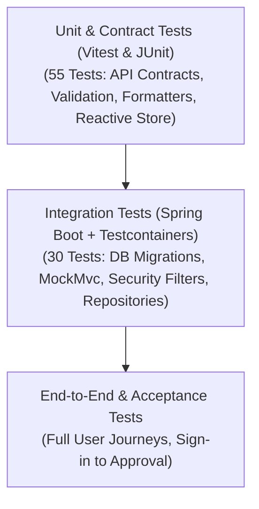

# Testing Strategy & Quality Assurance

**Project:** FlowLedger  
**Test Automation Status:** 100% Pass (85 Total Automated Tests)  
**Backend:** 30 Automated Integration & Unit Tests (JUnit 5 + Testcontainers PostgreSQL 16)  
**Frontend:** 55 Automated Unit, Contract & Integration Tests (Vitest 5.0.5)  

---

## 1. Testing Philosophy & Pyramid

FlowLedger follows a rigorous automated testing strategy to guarantee that business invariants, multi-tenant boundaries, financial calculations, and security configurations remain rock-solid across updates.



---

## 2. Backend Testing Architecture

### 2.1 Ephemeral PostgreSQL via Testcontainers
Backend integration tests do not rely on fragile external databases or H2 in-memory emulators (which fail to replicate PostgreSQL-specific dialect constraints, schemas, and extensions).

All integration tests extend [`PostgresIntegrationTestBase`](../flowLedger_backend/src/test/java/com/example/flowLedger_backend/PostgresIntegrationTestBase.java):

```java
@ActiveProfiles("test")
public abstract class PostgresIntegrationTestBase {

    @Container
    @ServiceConnection
    static PostgreSQLContainer<?> postgres = new PostgreSQLContainer<>("postgres:16")
            .withDatabaseName("flowledger_test")
            .withUsername("test_user")
            .withPassword("test_password");

    @DynamicPropertySource
    static void configureProperties(DynamicPropertyRegistry registry) {
        registry.add("spring.datasource.url", postgres::getJdbcUrl);
        registry.add("spring.datasource.username", postgres::getUsername);
        registry.add("spring.datasource.password", postgres::getPassword);
    }
}
```

### 2.2 Key Backend Testing Features
- **Automatic Resource Cleanup:** Testcontainers' Ryuk reaper terminates Docker containers immediately upon JVM shutdown.
- **Dynamic Port Binding:** Avoids port collision with local PostgreSQL development instances (`5435`).
- **Real Migration Verification:** Flyway executes all migrations (`V1`, `V2`, `V3`) against the container before tests run, validating schema definitions and constraints.
- **Full Security Filter Stack:** `MockMvc` tests execute with the complete `SecurityFilterChain`, authenticating requests using real HMAC-signed JWT cookies.

---

## 3. Frontend Testing Architecture

### 3.1 Vitest Unit & Contract Suite
The frontend testing suite runs under **Vitest 5.0.5** with full TypeScript support, executing 55 tests in under 300 ms.

### 3.2 Key Frontend Testing Features
- **Contract Verification:** Mocks the underlying `api.get` / `api.post` / `api.put` methods in [`frontend/lib/api/client.ts`](../frontend/lib/api/client.ts) to verify that `ApiInvoiceService` and `ApiApprovalService` pass query parameters, paths, and payloads matching the backend contract.
- **Comprehensive Validation Checks:** 17 tests validating invoice numbers, positive monetary amounts, date bounds (e.g. Due Date not earlier than Issue Date), and mandatory rejection reason lengths.
- **State Store Reactions:** Tests reactive updates to `useSyncExternalStore` when invoices are drafted, submitted, approved, or rejected.

---

## 4. Comprehensive Test Matrix

### 4.1 Backend Test Inventory (30 Tests)

| Test Class | Test Method | Type | Validated Invariant |
|---|---|---|---|
| **`DatabaseMigrationTest`** | `flyway_appliesAllMigrationsCleanly` | Integration | V1, V2, and V3 Flyway migrations execute cleanly on empty PostgreSQL schema. |
| **`ApplicationContextTest`** | `contextLoads` | Integration | Spring Boot ApplicationContext bootstraps without dependency injection errors. |
| **`HealthEndpointTest`** | `healthEndpoint_returnsUp` | Integration | Actuator `/actuator/health` returns `200 OK` and `{"status":"UP"}`. |
| **`PasswordEncoderTest`** | `bCryptPasswordEncoder_generatesValidSaltedHash` | Unit | BCrypt generates valid hashes and verifies passwords correctly. |
| **`InvalidConfigurationTest`**| `missingJwtSecret_failsContextStartup` | Integration | Missing 256-bit JWT secret safely aborts application startup. |
| **`IdentityRepositoryTest`** | `findByEmailIgnoreCase_returnsUser` | Integration | User lookup by email is case-insensitive. |
| | `existsByEmailIgnoreCase_detectsCollision` | Integration | Email uniqueness checks operate reliably. |
| **`SecurityConfigTest`** | `publicEndpoints_areAccessibleWithoutToken` | Integration | Public routes (`/actuator/health`, `/api/v1/auth/login`) permit unauthenticated access. |
| | `securedEndpoints_requireAuthentication` | Integration | `/api/v1/me` and `/api/v1/invoices` return `401 Unauthorized` without credentials. |
| **`AuthIntegrationTest`** | `login_withValidCredentials_returnsTokenAndCookie` | Integration | Correct login sets `access_token` cookie and returns user profile. |
| | `login_withInvalidPassword_returnsUnauthorized` | Integration | Bad credentials return `401 Unauthorized`. |
| | `getCurrentUser_withValidCookie_returnsSession` | Integration | Valid cookie resolves `/api/v1/me` with organization and permissions. |
| | `getCurrentUser_withValidBearerHeader_returnsSession`| Integration | Valid `Authorization: Bearer` resolves `/api/v1/me`. |
| | `logout_clearsAccessTokenCookie` | Integration | Logout returns expired `Set-Cookie` with Max-Age 0. |
| | `getCurrentUser_withExpiredToken_returnsUnauthorized`| Integration | Expired JWT returns 401. |
| **`InvoiceIntegrationTest`** | `createDraft_savesInvoiceAndLogsActivity` | Integration | Draft creation stores fields in PostgreSQL and adds `CREATED_DRAFT` activity. |
| | `checkDuplicate_detectsExistingInvoiceNumber` | Integration | Real-time duplicate check detects existing invoice number within tenant. |
| | `listInvoices_filtersByStatusAndDateRange` | Integration | Search and date range filtering return matching tenant invoices. |
| | `dashboardSummary_returnsAggregatedMetrics` | Integration | Dashboard summary endpoint calculates counts and queues correctly. |
| **`ApprovalIntegrationTest`**| `listPending_returnsPendingInvoicesQueue` | Integration | Approvals queue lists invoices with `status = 'PENDING_APPROVAL'`. |
| | `approve_transitionsStatusToApprovedAndLogsActivity`| Integration | Approver transitions status to `APPROVED` and records `APPROVED` activity. |
| | `reject_withReason_transitionsStatusToRejected` | Integration | Reject transitions status to `REJECTED`, records reason, and logs `REJECTED` activity. |
| | `reject_withoutReason_returnsBadRequest` | Integration | Reject without reason returns `400 Bad Request`. |
| | `approve_asViewer_returnsForbidden` | Integration | User with `VIEWER` role receives `403 Forbidden` on approval attempt. |

---

### 4.2 Frontend Test Inventory (55 Tests)

| Test File | Test Suite / Focus | Count | Validated Behavior |
|---|---|---|---|
| **`tests/validation.test.ts`** | Input & Business Validation | 17 | Validates positive decimal amounts, date logic, non-blank supplier names, alphanumeric invoice numbers, and mandatory rejection reason lengths. |
| **`tests/apiServices.test.ts`** | API Services & Contracts | 13 | Tests `ApiInvoiceService`, `ApiApprovalService`, and `teamService` query parameter construction, endpoint URLs, and 404/error handling. |
| **`tests/authService.test.ts`** | Authentication Service | 4 | Tests `authService.signIn`, `signOut`, and `getCurrentSession` integration with proxy client. |
| **`tests/invoiceService.test.ts`** | Mock & Store Invariants | 16 | Validates mock service compatibility, sorting logic, and state transition invariants. |
| **`tests/userFlows.test.ts`** | Component & User Journeys | 5 | Tests end-to-end user navigation, form submissions, and state reflections. |

---

## 5. Test Execution Commands

### Run All Backend Tests
```bash
cd flowLedger_backend
./mvnw test -o
```
*(Use `-o` for fast offline execution without remote Maven prefix polling).*

### Run a Specific Backend Test
```bash
./mvnw test -o -Dtest=InvoiceIntegrationTest
./mvnw test -o -Dtest=ApprovalIntegrationTest#approve_asViewer_returnsForbidden
```

### Run All Frontend Tests
```bash
cd frontend
npm test
```

### Run Frontend Tests in Watch Mode
```bash
npm run test:watch
```

### Verify Frontend TypeScript Types
```bash
npx tsc --noEmit
```

---

## 6. Continuous Integration (CI) Quality Gates

To merge changes to the `main` branch, the CI pipeline enforces:
1. **Zero Compiler Errors:** `./mvnw compile` (Java 25) and `npx tsc --noEmit` (TypeScript) must exit with code 0.
2. **100% Test Pass Rate:** All 30 backend tests and 55 frontend tests must pass.
3. **Migration Integrity:** Flyway migrations must successfully apply to a fresh PostgreSQL container.
